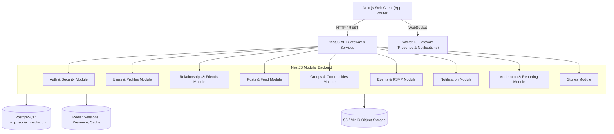
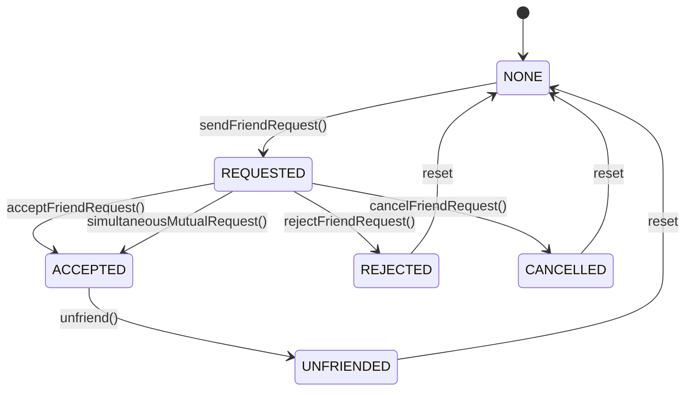

# Social Media Platform — Architecture & System Design

## 1. System Topology



---

## 2. Friendship State Machine



### Deterministic Simultaneous Mutual Requests Handling
If User A submits a friend request to User B while an active friend request from User B to User A already exists in `REQUESTED` state:
1. The transaction intercepts the duplicate inverse request.
2. The existing request status transitions immediately to `ACCEPTED`.
3. Bidirectional `Friendship` records are created within an atomic database transaction.
4. An alert/notification is dispatched to both participants notifying them of the completed connection.

---

## 3. Two-Way Blocking Architecture

Blocking creates an immediate, reciprocal barrier:
1. When User A blocks User B, an entry `Block(blockerId: A, blockedId: B)` is persisted.
2. In-memory and cached relationship sets are purged.
3. Any active friendship, pending friend requests, and follow associations between A and B are terminated.
4. Database queries for feeds, user searches, friend suggestions, group member rosters, and notifications automatically inject exclusion filters:
   ```sql
   WHERE authorId NOT IN (
       SELECT blockedId FROM Block WHERE blockerId = :currentUserId
       UNION
       SELECT blockerId FROM Block WHERE blockedId = :currentUserId
   )
   ```
5. Socket channels drop broadcasts across blocked relationship pairs.

---

## 4. Feed Ranking Engine

The personalized feed combines three vectors:
1. **Affinity**: Direct friendship weight ($w_a = 1.0$), followed accounts ($w_a = 0.6$), shared group membership ($w_a = 0.5$).
2. **Engagement**: Logarithmic sum of weighted interactions:
   $$\text{Engagement} = \ln(1 + \text{reactions} \times 1.5 + \text{comments} \times 3.0 + \text{shares} \times 4.0)$$
3. **Decay (Recency)**: Half-life decay over 24 hours:
   $$\text{Decay} = e^{-\frac{\ln(2)}{24} \cdot \Delta t_{\text{hours}}}$$

The ranked score is computed per candidate post, ordered descending, and paginated via opaque keyset cursors `base64(score:id)`.
