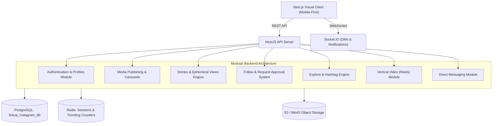
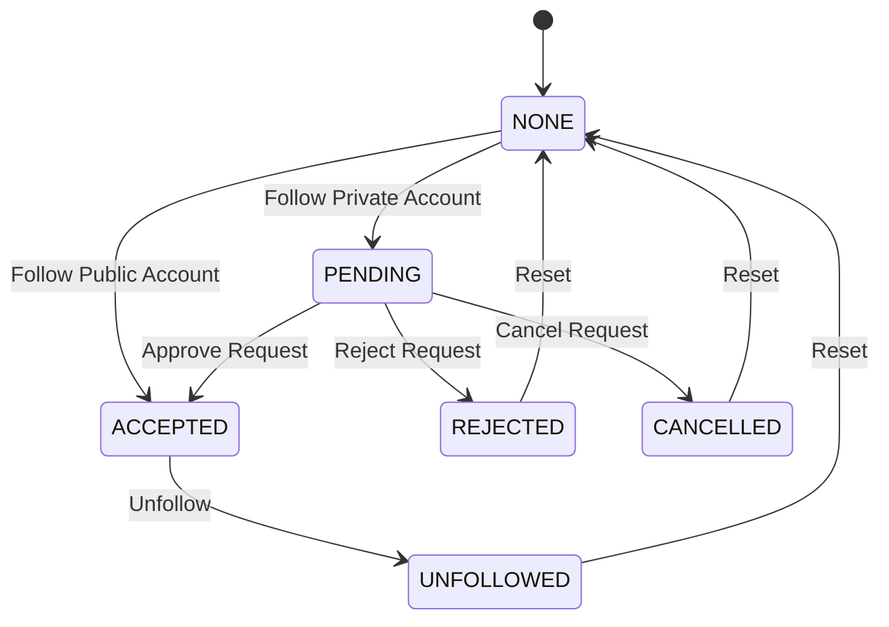
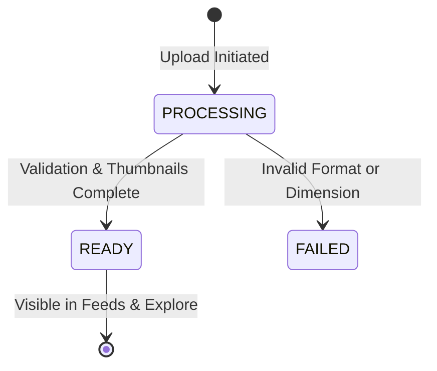

# Visual Media Discovery Platform — Architecture & Design

## 1. System Architecture

---

## 2. Follow Request State Machine (Private Accounts)

---

## 3. Media Processing Lifecycle

Only media in `READY` status is ever indexed or returned in feed queries.
