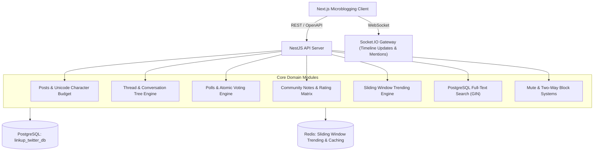
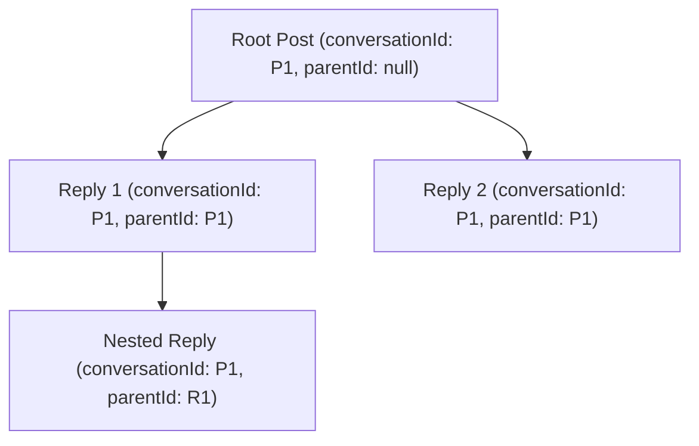

# Microblogging Platform — Architecture & System Design

## 1. System Topology

---

## 2. Conversation Tree Data Model

### Deterministic Tree Reconstruction
1. Given a post $P$, query all records where `conversationId = P.conversationId`.
2. Construct adjacency map `parentId -> children[]`.
3. Perform breadth-first or depth-first walk ordered by `createdAt ASC` to render branching discussion lines without orphaned nodes.

---

## 3. Simplified Community Notes Rating Algorithm

Let $R$ be the set of raters for a proposed note $N$.
Each rater $r \in R$ submits a rating $v_r \in \{+1 \text{ (Helpful)}, -1 \text{ (Not Helpful)}\}$.
Each rater carries a baseline topic bias $b_r \in [-1, 1]$ computed from their historical rating patterns.

A note is published with status `HELPFUL` when:
1. Total helpful ratings exceed a minimum threshold ($|R| \ge 3$).
2. The diversity variance $Var(\{b_r \mid v_r = +1\}) \ge 0.25$, demonstrating cross-perspective consensus.
