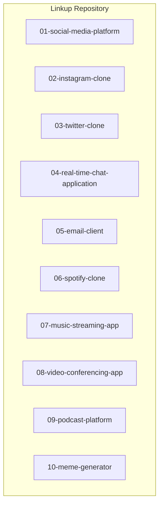

# Linkup — System Architecture

## Architectural Philosophy

Linkup adopts a strict shared-nothing architecture across projects. Each of the 10 applications is independently deployable and autonomous.

## Shared Architectural Patterns

Although isolated, each application adheres to disciplined engineering patterns:

1. **Layered API Design**: Controllers handle transport and validation, Services encapsulate domain logic, Repositories/Prisma manage database access.
2. **Strict Authorization**: Ownership and relationship-based access controls run at the service level on every read, update, and delete path. Client-supplied IDs are never trusted blindly.
3. **Database Isolation**: Dedicated PostgreSQL databases per application with explicit constraints, foreign keys, and indexes.
4. **Realtime Communication**: Authenticated WebSocket / Socket.IO connections with room-level authorization checks.
5. **Asynchronous Background Processing**: Offloading resource-heavy tasks (transcoding, emails, RSS parsing) to background queues (BullMQ / Redis).
